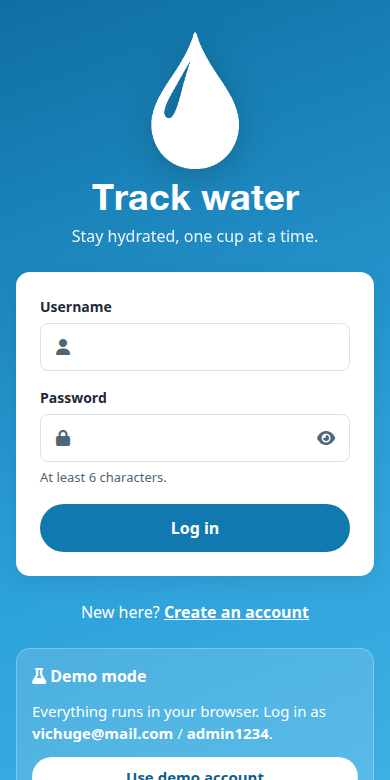
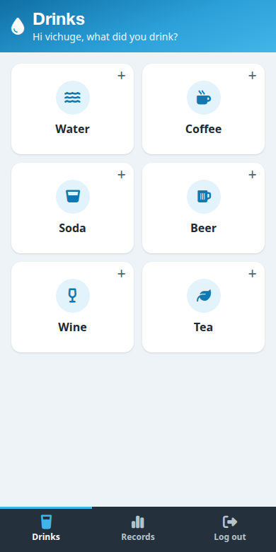
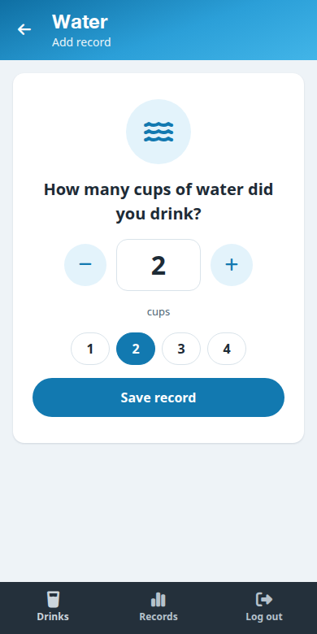
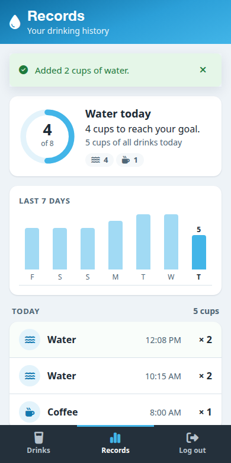

# Track water

> Log everything you drink and see how close you are to your daily water goal.

Track water is a mobile-first React app. It runs **fully offline**: a bundled mock API reproduces the original [Rails backend](https://github.com/vichuge/backend-track-app/tree/start-api), so you can log in, browse drinks and save records with no external services.

| Login | Drinks | Add record | Records |
| --- | --- | --- | --- |
|  |  |  |  |

## Live demo

[vichuge.github.io/frontend-track-app](https://vichuge.github.io/frontend-track-app/)

**Demo account:** `vichuge@mail.com` / `admin1234`. The login screen has a **Use demo account** button that fills these in. You can also sign up with any new username.

## Features

- Log in, sign up and log out. The session is kept across reloads and expires after 24 h.
- Pick a drink (water, coffee, soda, beer, wine, tea) and log how many cups you drank, using a stepper or quick picks.
- A progress ring shows today's water against an 8-cup goal, with a breakdown by drink.
- A 7-day bar chart and a history grouped by day ("Today", "Yesterday", …) with daily totals.
- Loading, error and empty states on every screen. Accessible forms. Automatic dark mode.
- Demo data lives in your browser (`localStorage`). **Reset demo data** on the login screen restores it.

## Built with

React 19 · React Router 7 · Redux Toolkit 2 · Vite 7 · Vitest 4 + Testing Library · ESLint 9 · Stylelint 16 · Font Awesome 6

## Getting started

Requirements: Node.js 22 (see `.nvmrc`) and npm.

```bash
git clone https://github.com/vichuge/frontend-track-app.git
cd frontend-track-app
npm ci
npm run dev        # http://localhost:5173
```

| Script | Description |
| --- | --- |
| `npm run dev` | Start the dev server |
| `npm test` | Run unit and integration tests |
| `npm run lint` | Run ESLint and Stylelint |
| `npm run build` | Create a production build in `dist/` |
| `npm run preview` | Serve the production build locally |
| `npm run check` | Lint, test and build (same as CI) |

### Using the real backend (optional)

The mock API is used by default. To point the app at a server that implements the same API, create `.env.local`:

```bash
VITE_API_URL=https://your-backend.example.com/api/v1
```

The API contract and the mock internals are documented in [AGENTS.md](./AGENTS.md).

## Deployment

Every push to `development` is built and published to GitHub Pages by `.github/workflows/deploy.yml`. In the repository settings, set **Pages → Source** to **GitHub Actions**.

## Author

👤 **Victor Pacheco**

- GitHub: [@vichuge](https://github.com/vichuge)
- LinkedIn: [victorpachecoflores](https://www.linkedin.com/in/victorpachecoflores/)

## 🤝 Contributing

Contributions, issues and feature requests are welcome. See the [issues page](https://github.com/vichuge/frontend-track-app/issues). Read [AGENTS.md](./AGENTS.md) for the project conventions.

## 📝 License

This project is licensed under [Creative Commons Legal Code](./LICENSE).
Artistic attribution for [Gregoire Vella](https://www.behance.net/gregoirevella).
